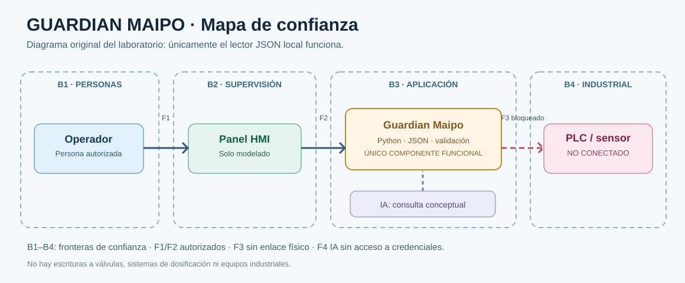

# Ficha de blindaje | Guardian Maipo

**Curso:** Taller DevSecOps sobre infraestructura crítica · Universidad Bernardo O'Higgins  
**Fecha de preparación:** 16-10-2026 · **Sector:** agua potable · **Sistema:** estación ficticia Maipo Sur  
**Equipo:** Daniel Silva · Allen Ramirez · Antonella Mancilla

## 1. Sistema y equipo

Desarrollamos un lector de registros totalmente ficticios para mostrar cómo un fallo de configuración podría comprometer la supervisión de una planta. El programa solo consulta un JSON local y jamás se comunica con equipos físicos.

**Roles propuestos para tres personas (confirmar con el grupo):**

| Integrante | Roles del taller |
|---|---|
| **Daniel Silva** | Operador de planta (criterio de seguridad física) y relator del cierre |
| **Allen Ramirez** | Desarrollador y guardián del pipeline |
| **Antonella Mancilla** | Auditora de IA y relatora de evidencias/registro |

## 2. Dibujo



Diagrama editable: [Mermaid](docs/arquitectura/diagrama.mmd). La **foto de un dibujo real del grupo** queda pendiente en `evidencias/diagrama-papel.jpg`; no se ha inventado evidencia presencial.

## 3. Tres amenazas priorizadas

| Amenaza y STRIDE | Consecuencia física posible | Control propuesto |
|---|---|---|
| **A1: suplantación por secreto expuesto** (S, I) | Acceso no autorizado al panel y pérdida de confiabilidad del tratamiento | Gitleaks, secreto de GitHub, revocación fuera del laboratorio |
| **A2: manipulación de entradas** (T, E) | Lecturas equivocadas que pueden inducir decisiones humanas incorrectas | Validación de identificadores y valores, Semgrep, sin ejecución shell |
| **A3: exposición de panel** (I, D, E) | Interrupción de la supervisión en un evento crítico | Trivy config, red restrictiva y política MAIPO-NET-001 |

El detalle STRIDE, prioridad e impacto está en [docs/amenazas/analisis.md](docs/amenazas/analisis.md).

## 4. Controles automáticos

| Control | Implementación | Estado verificable |
|---|---|---|
| Código propio | Gitleaks + Semgrep | **Aprobados en GitHub Actions** para `4a47309` según captura; URL específica pendiente |
| Dependencias | Trivy FS + OSV-Scanner | **Aprobados en GitHub Actions** para `4a47309` según captura; URL específica pendiente |
| Configuración | Trivy config con regla propia | **Aprobado en GitHub Actions** para `4a47309` según captura; URL específica pendiente |
| Inventario | CycloneDX en Trivy + SBOM local | SBOM local generada; artefacto remoto pendiente |
| Integración | Unittest + compilación + escenarios | **12/12 pruebas y 4/4 escenarios aprobados localmente** |

**URL de Actions del nuevo repositorio:** https://github.com/Allen2109/Guardian_Maipo_Equipo_DSA/actions  
**URL de ejecución con fallo intencional:** pendiente de enlazar; Gitleaks detectó 1 credencial ficticia según captura.  
**URL de ejecución corregida en verde:** https://github.com/Allen2109/Guardian_Maipo_Equipo_DSA/actions/runs/38987814463

## 5. Hallazgos y gestión

| Hallazgo | Gravedad | Decisión y justificación | Responsable / estado |
|---|---|---|---|
| Contraseña ficticia escrita dentro de un archivo de prueba temporal | Alta didáctica | **Corregir:** usar `password_env: PLC_PASSWORD` y sustituir la credencial si se hubiese comprometido | Allen / rojo y verde confirmados en capturas; agregar enlace del run rojo |
| Entrada que se concatena a un comando en el parche de IA | Alta | **Rechazar:** no ejecutar comandos externos con datos sin validar | Antonella / análisis escrito |
| Regla que admite origen global `0.0.0.0/0` | Alta | **Corregir:** limitar a una red de documentación aprobada | Allen / política preparada |
| Requisitos de operación industrial real | Muy alta | **Postergar:** pruebas con fabricante, segmentación, autorizaciones y recuperación antes de considerar despliegue | Daniel / fuera del alcance académico |

## 6. Auditoría de IA: cuatro preguntas obligatorias

1. **¿Existe el paquete?** La propuesta nombra `plc_helper_utils`; **no hay registro de verificación independiente del equipo**. No autorizar su instalación.
2. **¿Qué hace con la entrada?** Construye una línea de comandos concatenando texto y pretende ejecutarla mediante shell; entrada potencialmente manipulable.
3. **¿Apaga una protección?** Utiliza `verify=False`, que desactiva la verificación del certificado TLS.
4. **¿A dónde envía los datos?** Usa un destino denominado `TELEMETRIA` sin definición ni justificación en el fragmento propuesto.

**Veredicto: RECHAZAR** el parche de IA. Análisis completo: [veredicto.md](docs/auditoria-ia/veredicto.md). **PR real:** [Pull Request #1 - Auditoría de IA](https://github.com/Allen2109/Guardian_Maipo_Equipo_DSA/pull/1). **Estado:** Abierta, sin fusionar con main.
## 7. Pendientes antes de una planta real

Rotación y revocación comprobada de secretos; autenticación con roles; segmentación OT/TI; autorización del fabricante; pruebas de fallos y recuperación; monitoreo y bitácoras protegidas; validación por el personal de operación. **Nada de esto se considera implantado.**

## 8. Reproducción

```bash
python -m pip install --require-hashes -r requirements.lock
PYTHONPATH=src python -m unittest discover -s tests -v
python scripts/revisar_sectores.py
python scripts/compilar.py
```

En GitHub ejecutar los workflows desde `Actions` y conservar las URL y sus informes en [evidencias/VALIDACION.md](evidencias/VALIDACION.md).

**Cierre propuesto:** [guion 90 segundos](docs/exposicion/guion.md). **Fuentes:** [referencias](docs/REFERENCIAS.md).
